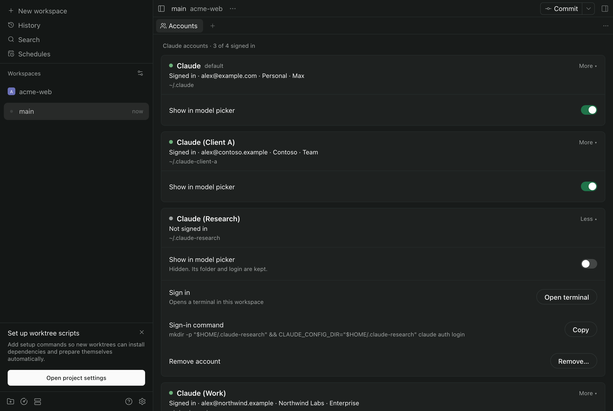

# Accounts for Paseo

Run several Claude and Codex accounts side by side in Paseo: work, personal, a client's, or ten
of them. Each account appears as its own provider in the model picker, with its own login,
settings and history. Accounts adds, signs in, checks, hides and removes them from one screen.

Works on macOS, Linux and Windows.


<p>
  
  
</p>



<sub>Screenshots use made-up accounts. They come from Paseo's own web app driven by
`tests/screenshots`.</sub>

## What you can do

- **Add an account.** Pick Claude or Codex, type a name such as "Work", and it appears in the
  model picker as "Claude (Work)" with all of that provider's models and modes.
- **Sign in.** Open a terminal that runs the right sign-in command for that account, or copy the
  command and run it yourself.
- **See every account's usage.** Paseo's Usage page gets a "Claude accounts" and a "Codex
  accounts" card for each extra account, with the same limits and plan Paseo shows for your
  default one.
- **See who's signed in.** Each account shows whether it's signed in, with its email,
  organisation and plan.
- **Keep the picker tidy.** Hide an account you don't use often; its login stays, ready for later.
- **Remove an account.** This removes it from Paseo but keeps its folder and login, so adding it
  again with the same name picks the login back up.
- **Create profiles on top.** Paseo's own "Create profile" works with any account, for example
  "UI work: Opus on Claude (Work)".

## Install

With Paseo 0.16.1 or later:

```sh
paseo plugin install npm:@kevlai22/paseo-accounts@0.1.0
```

Open it from **Settings → Plugins → Accounts**, as a tab from a workspace's **+** menu, or by
searching "accounts" in the Command Center. In a workspace tab, sign-in terminals open in that
workspace.

## How it works

Paseo already supports extra providers that extend Claude or Codex with their own environment
([custom providers](https://paseo.sh/docs/custom-providers)). Each CLI keeps its login in a
folder you choose:

| Provider | Variable | Default folder | Extra account folder |
| --- | --- | --- | --- |
| Claude | `CLAUDE_CONFIG_DIR` | `~/.claude` | `~/.claude-<name>` |
| Codex | `CODEX_HOME` | `~/.codex` | `~/.codex-<name>` |

Adding an account creates that folder and a provider entry such as:

```json
"agents": {
  "providers": {
    "claude-work": {
      "extends": "claude",
      "label": "Claude (Work)",
      "env": { "CLAUDE_CONFIG_DIR": "/Users/you/.claude-work" }
    }
  }
}
```

Accounts makes the change through Paseo's config API, so it takes effect at once without a
restart. On macOS, Claude stores each folder's login under its own Keychain item, so accounts
never overwrite each other.

Status comes from each account's own files: the identity Claude records in `.claude.json`, the
identity claims in Codex's `auth.json`, and whether a login exists. For status, Accounts never
reads a Keychain secret; it only checks that the item exists.

Usage uses Paseo's own Claude and Codex usage code, unmodified and pointed at each extra
account's folder ([server/vendor/paseo-usage](server/vendor/paseo-usage/README.md)). Like Paseo's
built-in usage cards, it reads that account's login (from its credentials file, or on macOS its
Keychain item) and sends it only to that provider's own usage API. Accounts never shows, logs or
stores a token.

## Setting an account up by hand

You don't need the plugin for this; it automates these steps. Replace `work` with your own name
(lowercase letters, digits and dashes).

### 1. Create the folder and sign in

The browser sign-in uses whichever account your browser is already signed in to. To add a
*different* account, sign out there first, use a private window, or (for Claude) pass
`--email you@example.com`.

macOS and Linux:

```sh
mkdir -p ~/.claude-work && CLAUDE_CONFIG_DIR=~/.claude-work claude auth login
mkdir -p ~/.codex-work  && CODEX_HOME=~/.codex-work codex login
```

Windows (PowerShell):

```powershell
New-Item -ItemType Directory -Force -Path "$env:USERPROFILE\.claude-work" | Out-Null; $env:CLAUDE_CONFIG_DIR = "$env:USERPROFILE\.claude-work"; claude auth login
New-Item -ItemType Directory -Force -Path "$env:USERPROFILE\.codex-work" | Out-Null; $env:CODEX_HOME = "$env:USERPROFILE\.codex-work"; codex login
```

Codex refuses to start when `CODEX_HOME` doesn't exist, which is why the folder comes first.
In PowerShell the variable stays set for the rest of that window; run
`Remove-Item Env:CLAUDE_CONFIG_DIR` (or `Env:CODEX_HOME`) afterwards, or close the window. (The
command Accounts gives you to copy clears it for you.)

Check which account each folder holds: `claude auth status` (Claude) or `codex login status`
(Codex), with the same variable set.

### 2. Add it to Paseo

Add a provider entry to `~/.paseo/config.json` (Windows: `%USERPROFILE%\.paseo\config.json`).
Use the full folder path; on Windows, escape backslashes (`"C:\\Users\\you\\.claude-work"`).

```json
"agents": {
  "providers": {
    "claude-work": { "extends": "claude", "label": "Claude (Work)", "env": { "CLAUDE_CONFIG_DIR": "/Users/you/.claude-work" } },
    "codex-work":  { "extends": "codex",  "label": "Codex (Work)",  "env": { "CODEX_HOME": "/Users/you/.codex-work" } }
  }
}
```

Then apply it without restarting: `paseo reload`.

### 3. Check it

`paseo provider ls` lists the new providers. `paseo provider diagnostic claude-work` shows which
account it uses (`configDirectory`, organisation and plan).

### 4. Optional: a shortcut for your terminal

```sh
alias claude-work='CLAUDE_CONFIG_DIR="$HOME/.claude-work" claude'   # zsh or bash
```

```powershell
function claude-work { $env:CLAUDE_CONFIG_DIR = "$env:USERPROFILE\.claude-work"; try { claude @args } finally { Remove-Item Env:CLAUDE_CONFIG_DIR } }   # PowerShell profile
```

### Things a new account doesn't share

A new folder starts empty: no settings, permissions, hooks, skills, plugins or MCP servers.
Add what you need to that account, for example
`CLAUDE_CONFIG_DIR=~/.claude-work claude mcp add --scope user ...`. Project files such as
`CLAUDE.md` in a repository still apply, because they live in the project.

## Many accounts

Nothing is limited to one extra account:
- Ten Claude accounts are ten folders and ten providers.
- Status checks run at most three at a time and are cached for a minute.
- Hidden accounts stay out of the model picker.

## Limits

- Sign-in happens in the CLI's own browser flow. Accounts opens the terminal for it but can't
  sign in for you.
- "Open terminal" needs a workspace on the host. Without one, copy the sign-in command.
- A running agent's usage shows on Paseo's built-in card for that session; the "Claude accounts"
  and "Codex accounts" cards on the Usage page list every extra account, hidden ones included.
  Turn any card off on the Usage page itself.
- Accounts manages entries named `claude-<name>` and `codex-<name>`. Other provider entries with
  their own folder are listed, but can only be hidden or shown here.
- Removing an account doesn't delete its folder, and the login stays in it. Delete the folder
  yourself if you want it gone; on macOS also delete its "Claude Code-credentials-…" Keychain item.

## Development

```sh
npm ci --ignore-scripts
npm run typecheck
npm test
```

CI runs the type check and tests on macOS, Linux and Windows.

To redo the screenshots on macOS, build a fictional home and an isolated Paseo daemon
(`tests/screenshots/demo.sh`), then drive Paseo's bundled web app with Playwright
(`tests/screenshots/capture.mjs`), and stop the demo with `tests/screenshots/demo.sh --stop`. They
use a made-up home folder and their own Paseo home, clear `CLAUDE_CONFIG_DIR` and `CODEX_HOME`,
and only stop processes they started. The comments at the top of each file give the arguments. The design and verified facts
behind it are in [docs/DESIGN.md](docs/DESIGN.md).

MIT licensed. The vendored usage code in `server/vendor/paseo-usage` is Paseo's, under the
Apache License 2.0.
