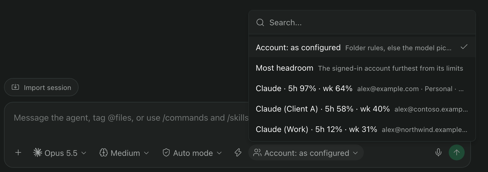
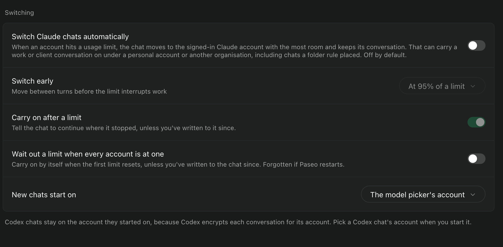
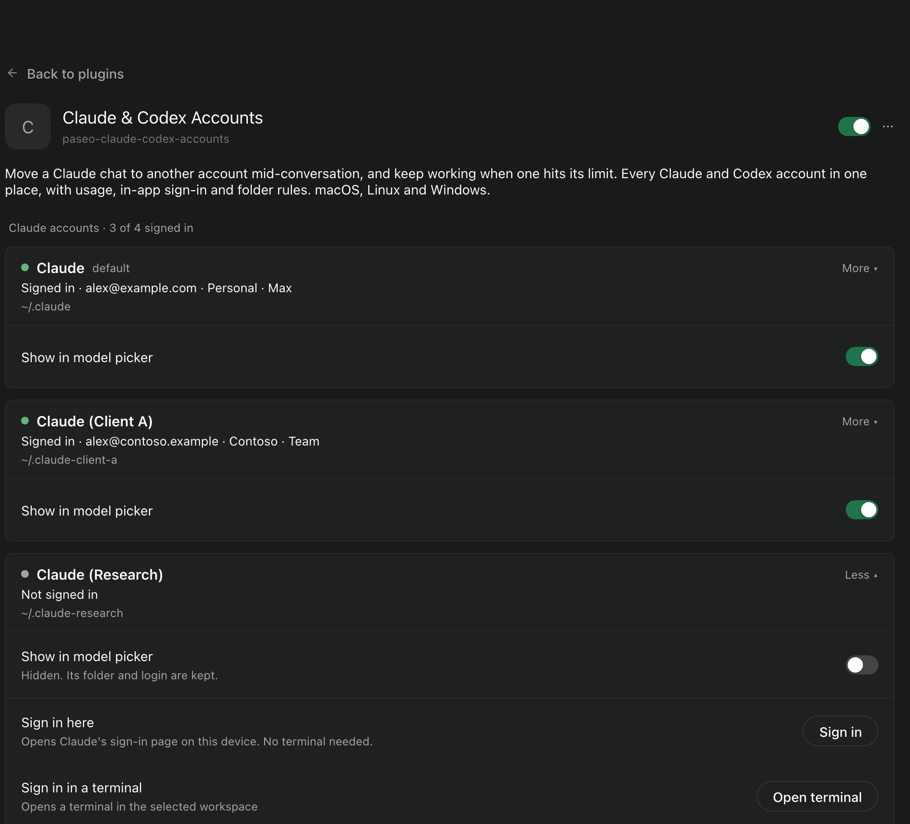
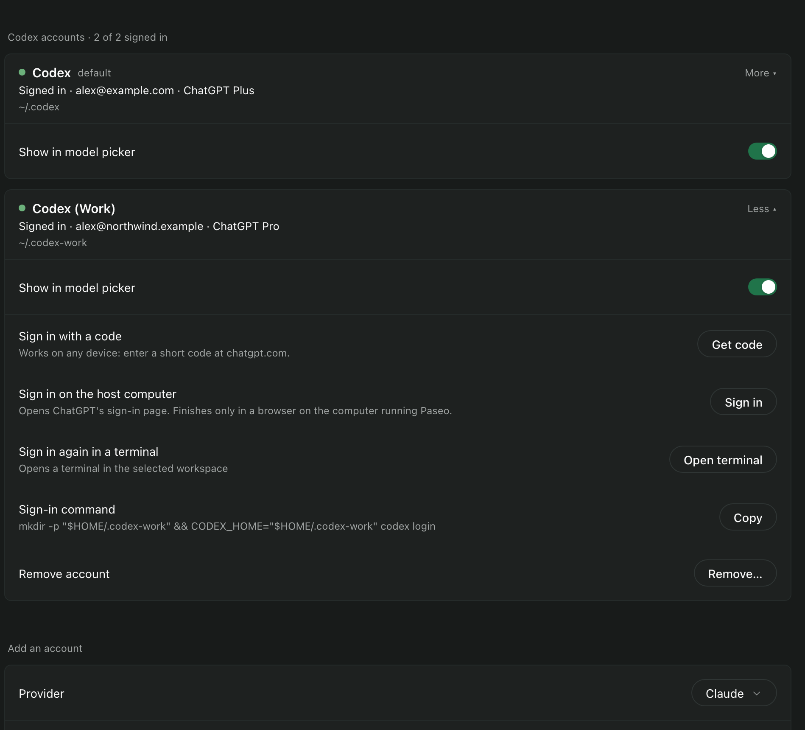
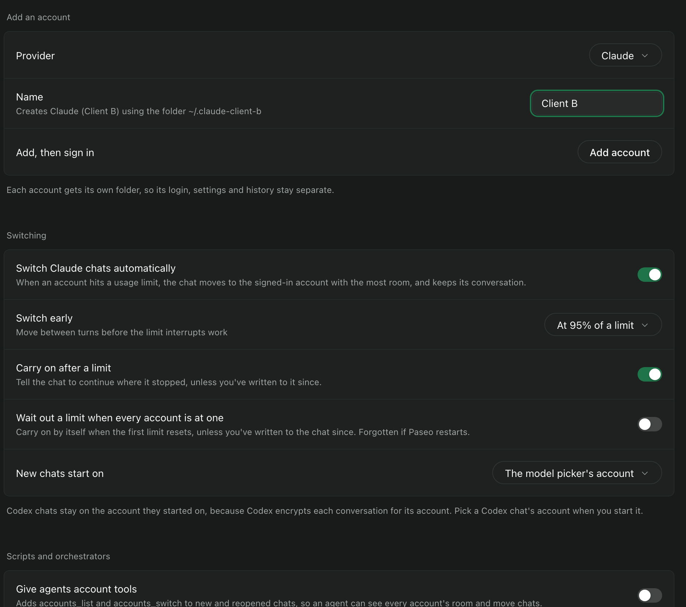

# Claude & Codex Accounts

**Move a Claude chat to another account mid-conversation, and keep working when one hits its
limit.** Run all your Claude and Codex accounts side by side in Paseo — work, personal, a
client's — and hand a chat from one to the next without losing a word.

Works on macOS, Linux and Windows.



## What makes it different

- **A chat keeps everything when it changes account.** The plugin swaps only the login a chat uses.
  The conversation, your settings, MCP servers, skills and hooks stay exactly as they were, so
  nothing is copied, linked or merged between folders.
- **Failover that doesn't depend on wording.** A chat moves when its account hits a limit,
  spotted either from the CLI's message *or* from the account's real usage reading, so a
  reworded message doesn't quietly turn failover off. It can also move early, at 80–95%.
- **It can carry on by itself.** After a move it tells the chat to continue, but only if you
  haven't written to it since. When every account is at its limit, it can wait for the first reset.
- **Every account's usage, before you start.** Each extra account gets its own card on Paseo's
  Usage page, and the message box shows how much room each one has.
- **Sign in from anywhere**, phone included: Claude's page gives you a code to paste back, and
  Codex shows a short device code. A terminal works too.
- **Folder rules with wildcards:** `~/work/**` → Work, `~/clients/acme` → Client A. The most
  specific rule wins, on every platform.
- **Plain folders you can use from a terminal.** Accounts live in `~/.claude-<name>` and
  `~/.codex-<name>`, the same folders `CLAUDE_CONFIG_DIR=~/.claude-work claude` uses.
- **Built for scripts and orchestrators:** start a chat on an account with
  `paseo run --label account=claude-work`, or let agents move chats with two tools.

<p>
  
  
</p>

<sub>Screenshots use made-up accounts and usage. They come from Paseo's own web app driven by
`tests/screenshots`.</sub>

## Install

With Paseo 0.16.1 or later:

```sh
paseo plugin install npm:@kevlai22/paseo-claude-codex-accounts@1.0.0
```

Open it from **Settings → Plugins → Claude & Codex Accounts**, from a workspace's **+** menu (**Accounts**), or by
searching "accounts" in the Command Center.

## Using it

**Add an account.** Pick Claude or Codex, type a name such as "Work", and sign in with **Sign in
here**. It also appears in the model picker as "Claude (Work)".

**Pick the account for a chat** from the **Account** control in the message box. In a new chat,
choose an account, **Most headroom**, or leave it **as configured** (folder rules, else the model
picker's account). In a running Claude chat, choosing another account moves the chat there; if a
turn is running, it moves when the turn ends.

**Let it switch for you.** With **Switch Claude chats automatically** on (the default), a chat
that hits a usage limit moves to the signed-in account with the most room and carries on. Each
move adds a note to the chat saying where it went and why. To stop two busy accounts trading a
chat back and forth, a chat moves automatically at most four times in ten minutes, and early
moves only go to an account with real room.

**Two ways to set up an account:**

| You pick in the model picker | The chat uses |
| --- | --- |
| **Claude**, with an account chosen in the message box or by a folder rule | your usual `~/.claude` settings, MCP servers and history, signed in as that account |
| **Claude (Work)** | everything from `~/.claude-work`: its own settings, MCP servers and history |

**Scripts and orchestrators.** `paseo run --label account=claude-work "…"` (or
`paseo import --label …`) starts a Claude chat on that account. For a Codex chat, pick the account's
provider instead: `paseo run --provider codex-work "…"`. Turn on **Give agents account
tools** and agents get `accounts_list` (every account's room, and which one a chat uses) and
`accounts_switch` (move this chat or another).

## How switching works

Claude Code reads its login from `CLAUDE_SECURESTORAGE_CONFIG_DIR` when it is set, and everything
else (settings, transcripts) from `CLAUDE_CONFIG_DIR`. The plugin records the account on the chat and,
whenever Paseo opens that chat's session, points `CLAUDE_SECURESTORAGE_CONFIG_DIR` at the account's
folder (on macOS, the Keychain item Claude derives from that folder). Then it asks Paseo to reopen
the chat. The conversation resumes from the same transcript, on the new login.

Codex can't do this: it encrypts a conversation for the ChatGPT account that started it. So Codex
chats pick their account when they start (by the message box, a folder rule or **Most headroom**),
and when a Codex account hits its limit the plugin says which account to start a new chat on.

Accounts themselves are ordinary Paseo [custom providers](https://paseo.sh/docs/custom-providers),
each with its own folder:

| Provider | Variable | Default folder | Extra account folder |
| --- | --- | --- | --- |
| Claude | `CLAUDE_CONFIG_DIR` | `~/.claude` | `~/.claude-<name>` |
| Codex | `CODEX_HOME` | `~/.codex` | `~/.codex-<name>` |

Adding an account creates the folder and a provider entry such as:

```json
"agents": {
  "providers": {
    "claude-work": {
      "extends": "claude",
      "label": "Claude (Work)",
      "env": { "CLAUDE_CONFIG_DIR": "/Users/you/.claude-work" }
    }
  }
}
```

The plugin makes the change through Paseo's config API, so it takes effect at once.

## Privacy

- Status comes from each account's own files: the identity Claude records in `.claude.json`, the
  identity claims in Codex's `auth.json`, and whether a login exists. For status, the plugin never reads
  a Keychain secret; it only checks that the item exists.
- Usage uses Paseo's own Claude and Codex usage code, unmodified and pointed at each extra account's
  folder ([server/vendor/paseo-usage](server/vendor/paseo-usage/README.md)). Like Paseo's built-in
  usage cards, it reads that account's login and sends it only to that provider's own usage API.
- In-app sign-in runs the CLIs' own sign-in (`claude auth login`, `codex app-server`). The code you
  paste goes straight to the CLI. The plugin never shows, logs or stores a token.
- If signing in again puts a *different* person's login in a folder, the plugin warns you, because
  every chat using that account would then run as them.

<p>
  
  
</p>

## Setting an account up by hand

You don't need the plugin for this; it automates these steps. Replace `work` with your own name
(lowercase letters, digits and dashes).

### 1. Create the folder and sign in

The browser sign-in uses whichever account your browser is already signed in to. To add a
*different* account, sign out there first, use a private window, or (for Claude) pass
`--email you@example.com`.

macOS and Linux:

```sh
mkdir -p ~/.claude-work && CLAUDE_CONFIG_DIR=~/.claude-work claude auth login
mkdir -p ~/.codex-work  && CODEX_HOME=~/.codex-work codex login
```

Windows (PowerShell):

```powershell
New-Item -ItemType Directory -Force -Path "$env:USERPROFILE\.claude-work" | Out-Null; $env:CLAUDE_CONFIG_DIR = "$env:USERPROFILE\.claude-work"; claude auth login
New-Item -ItemType Directory -Force -Path "$env:USERPROFILE\.codex-work" | Out-Null; $env:CODEX_HOME = "$env:USERPROFILE\.codex-work"; codex login
```

Codex refuses to start when `CODEX_HOME` doesn't exist, which is why the folder comes first.
In PowerShell the variable stays set for the rest of that window; run
`Remove-Item Env:CLAUDE_CONFIG_DIR` (or `Env:CODEX_HOME`) afterwards, or close the window. (The
command the plugin gives you to copy clears it for you.)

Check which account each folder holds: `claude auth status` (Claude) or `codex login status`
(Codex), with the same variable set.

### 2. Add it to Paseo

Add a provider entry to `~/.paseo/config.json` (Windows: `%USERPROFILE%\.paseo\config.json`).
Use the full folder path; on Windows, escape backslashes (`"C:\\Users\\you\\.claude-work"`).

```json
"agents": {
  "providers": {
    "claude-work": { "extends": "claude", "label": "Claude (Work)", "env": { "CLAUDE_CONFIG_DIR": "/Users/you/.claude-work" } },
    "codex-work":  { "extends": "codex",  "label": "Codex (Work)",  "env": { "CODEX_HOME": "/Users/you/.codex-work" } }
  }
}
```

Then apply it without restarting: `paseo reload`.

### 3. Check it

`paseo provider ls` lists the new providers. `paseo provider diagnostic claude-work` shows which
account it uses (`configDirectory`, organisation and plan).

### 4. Optional: a shortcut for your terminal

```sh
alias claude-work='CLAUDE_CONFIG_DIR="$HOME/.claude-work" claude'   # zsh or bash
```

```powershell
function claude-work { $env:CLAUDE_CONFIG_DIR = "$env:USERPROFILE\.claude-work"; try { claude @args } finally { Remove-Item Env:CLAUDE_CONFIG_DIR } }   # PowerShell profile
```

### Things a new account doesn't share

A new folder starts empty: no settings, permissions, hooks, skills, plugins or MCP servers.
Add what you need to that account, for example
`CLAUDE_CONFIG_DIR=~/.claude-work claude mcp add --scope user ...`. Project files such as
`CLAUDE.md` in a repository still apply, because they live in the project.

## Many accounts

Nothing is limited to one extra account:
- Ten Claude accounts are ten folders and ten providers.
- Status checks run at most three at a time and are cached for a minute; usage readings are
  cached and never fetched more than once every 90 seconds per account.
- Hidden accounts stay out of the model picker.

## Limits

- **Codex chats can't change account** (see above). New Codex chats can.
- **MCP servers that sign in with OAuth** keep those logins with the account, so after a switch
  a chat may need to sign in to such a server again on the new account.
- **A switched chat's `/status`** shows the email cached in its own folder, not the account it now
  runs on. The plugin's **Account** control shows the real one. Likewise, Paseo's built-in usage card for
  that chat shows its provider's account; the plugin's cards show each account.
- **Waiting out a limit** lives in the plugin, so a Paseo restart forgets it (the note in the chat
  says when it would have carried on).
- The plugin manages entries named `claude-<name>` and `codex-<name>`. Other provider entries with
  their own folder are listed and can be switched to, but only hidden or shown here.
- Removing an account doesn't delete its folder, and the login stays in it. Delete the folder
  yourself if you want it gone; on macOS also delete its "Claude Code-credentials-…" Keychain item.
- "Open terminal" needs a workspace on the host. Without one, sign in here or copy the command.

## Development

```sh
npm ci --ignore-scripts
npm run typecheck
npm test
```

CI runs the type check and tests on macOS, Linux and Windows.

To redo the screenshots on macOS, build a fictional home and an isolated Paseo daemon
(`tests/screenshots/demo.sh`), then drive Paseo's bundled web app with Playwright
(`tests/screenshots/capture.mjs`), and stop the demo with `tests/screenshots/demo.sh --stop`. They
use a made-up home folder and their own Paseo home, clear `CLAUDE_CONFIG_DIR` and `CODEX_HOME`,
and only stop processes they started. The comments at the top of each file give the arguments. The design and verified facts
behind it are in [docs/DESIGN.md](docs/DESIGN.md).

MIT licensed. The vendored usage code in `server/vendor/paseo-usage` is Paseo's, under the
Apache License 2.0, and the limit-message patterns are adapted from ZeroSub (MIT). See
[THIRD_PARTY_NOTICES.md](THIRD_PARTY_NOTICES.md).
